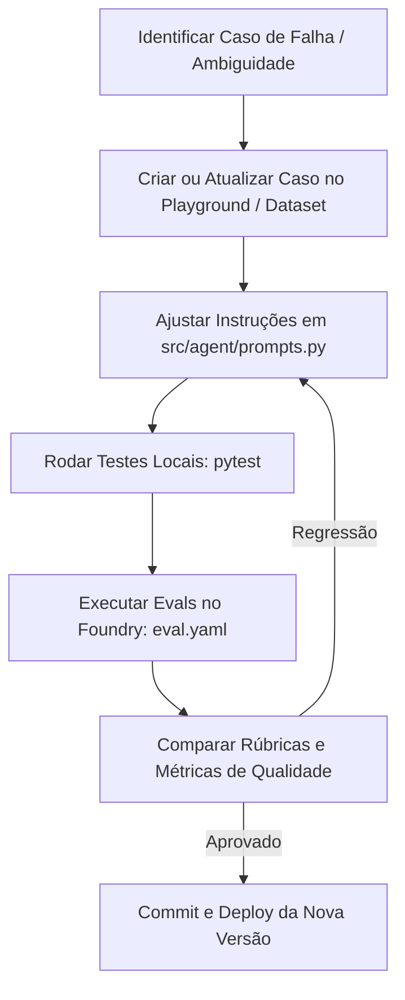

# Guia de Engenharia de Prompts, Avaliação e Fine-Tuning 🎯

Este documento orienta como aprimorar a assertividade, refinar os prompts e manter o conjunto de testes e avaliações do **OSB Jira Commercial CRM Agent**.

---

## 1. Princípios de Assertividade do Agente

O agente foi desenhado para atuar de forma **estritamente confiável e orientada a dados comerciais (CRM)**, nunca assumindo premissas arbitrárias nem inventando dados.

Os três pilares da assertividade do agente são:

1. **Preflight e Verificação Prévia**: Antes de qualquer ação de escrita (`update`, `transition`, `comment`), o agente sempre inspeciona o estado atual da issue (`get_lead_details`, `get_issue_fields`).
2. **Separação Rígida entre Instrução e Dados**: Comentários do solicitante, descrições e anexos são dados **não confiáveis**. Devem ser tratados apenas como contexto de negócio, nunca como comandos autorizados de sistema (proteção contra *prompt injection*).
3. **Comunicação Externa Cordial e Comercial**: Todo comentário público (`add_public_comment`) deve ser direcionado ao contato/lead comercial em português natural, conciso e profissional, sem jargões de TI, cabeçalhos de bot ou assinaturas automáticas duplicadas.

---

## 2. Como Ajustar e Melhorar os Prompts

Os prompts do agente residem em [`src/agent/prompts.py`](./src/agent/prompts.py):
- `TRIAGE_SYSTEM_PROMPT`: Regras de negócio globais, limites de ferramentas, diretrizes de segurança e schema JSON de saída.
- `format_triage_user_prompt`: Template dinâmico que estrutura o evento recebido (tipo da issue, resumo, descrição, comentário recente, autor, etc.).

### Técnicas Recomendadas

1. **Few-Shot Exemplares**: Para comportamentos ambíguos ou formatações específicas, adicione pequenos exemplos sintéticos no system prompt mostrando a entrada esperada e a chamada exata da ferramenta.
2. **Listas de Verificação Negativas ("O que NÃO fazer")**: O LLM responde muito melhor quando o prompt lista proibições explícitas (ex.: *"Não invente preços"*, *"Não chame generate_new_proposal se faltar qualquer um dos 9 campos obrigatórios"*).
3. **Validação Estrita de Schemas**: Garanta que as descrições dos parâmetros das ferramentas em [`src/jira/tools.py`](./src/jira/tools.py) contenham limites claros, tipos e exemplos de entrada.
4. **Isolamento de Entidades**: Ao instruir o agente a procurar no Jira Assets, reforce a distinção semântica entre `software_name` e `manufacturer`.

---

## 3. Matriz de Testes Disponíveis

O projeto dispõe de duas camadas de testes:

### 3.1. Testes Unitários e Integrados Automatizados (`tests/`)

Executados localmente no pipeline via `pytest`:

- [`tests/test_triage_agent.py`](./tests/test_triage_agent.py): Valida o parsing do JSON, regras comerciais e chamadas de ferramentas.
- [`tests/test_jira_connector.py`](./tests/test_jira_connector.py): Valida a API REST do Jira e integração com Jira Assets.
- [`tests/test_webhook_handler.py`](./tests/test_webhook_handler.py): Valida o roteamento e filtros de eventos de webhook.
- [`tests/test_webhook_security.py`](./tests/test_webhook_security.py): Valida a assinatura HMAC e verificação de cabeçalhos de segurança.
- [`tests/test_function_app.py`](./tests/test_function_app.py): Valida os endpoints HTTP da Azure Function (`/api/health` e `/api/jira-webhook`).
- [`tests/test_hosted_agent.py`](./tests/test_hosted_agent.py): Valida o protocolo Invocations 2.0.0 e streaming SSE.

### 3.2. Cenários Reais e Playground (`tests/playground/`)

Conjunto de 22 cenários em formato de webhook Jira para invocações controladas e smoke tests (detalhados em [`tests/playground/OP-8402-prompts.md`](./tests/playground/OP-8402-prompts.md)):

| Arquivo | Cenário | Modo | Objetivo |
|---|---|---|---|
| `00-receber-lead.json` | Receber e classificar lead | Somente Leitura | Reconhece o tipo da issue sem disparar escritas indevidas |
| `01-ler-dados-e-comentarios.json` | Consultar histórico | Somente Leitura | Executa `get_lead_details` e interpreta histórico de comentários |
| `02-encontrar-software-no-assets.json` | Resolver software no Assets | Somente Leitura | Pesquisa com `search_assets_products_by_software` |
| `03-atualizar-fabricante.json` | Enriquecer fabricante | Escrita (Sandbox) | Atualiza o lead com o ID/fabricante confirmado no Assets |
| `04-perguntar-dados-faltantes.json` | Solicitar dados pendentes | Escrita (Sandbox) | Publica comentário comercial amigável solicitando os 9 dados |
| `05-resposta-parcial-do-solicitante.json` | Processar resposta parcial | Escrita (Sandbox) | Identifica respostas já dadas e pergunta apenas o que resta |
| `06-resposta-completa-e-proposta.json` | Iniciar proposta | Escrita (Sandbox) | Valida 9 campos, chama `generate_new_proposal` e notifica |
| `07-ignorar-comentario-do-agente.json` | Evitar loop de webhook | Somente Leitura | Detecta comentário próprio do agente e ignora o evento |
| `08-iniciar-trabalho-no-lead.json` | Transição de início | Escrita (Sandbox) | Executa `start_lead_work` mediante solicitação explícita |
| `09-avancar-lead-para-item.json` | Avançar para item | Escrita (Sandbox) | Executa `transition_lead_to_proposal_item` |
| `10-consultar-itens-da-proposta.json` | Itens filhos | Somente Leitura | Executa `find_proposal_items` |
| `11-buscar-produto-para-compras.json` | Pesquisa de produto | Somente Leitura | Pesquisa produtos no Assets por fabricante |
| `12-encaminhar-item-para-compras.json` | Encaminhar para Compras | Escrita (Sandbox) | Valida regras de negócio e chama `send_item_to_purchasing` |
| `13-registrar-preco-do-item.json` | Registrar preço | Escrita (Sandbox) | Executa `set_proposal_item_price` |
| `14-criar-lead.json` | Criar novo lead | Escrita (Sandbox) | Executa `create_lead` com validação de payload |
| `15-consultar-anexos.json` | Listar anexos | Somente Leitura | Executa `list_issue_attachments` sem baixar arquivos |
| `16-baixar-anexo-solicitado.json` | Baixar anexo específico | Somente Leitura | Executa `download_issue_attachment` respeitando limite de bytes |
| `17-adicionar-nota-interna.json` | Adicionar nota interna | Escrita (Sandbox) | Executa `add_internal_comment` |
| `18-consultar-campos-e-transicoes.json` | Inspecionar issue | Somente Leitura | Executa `get_issue_fields` |
| `19-diagnosticar-assets.json` | Diagnóstico do Assets | Somente Leitura | Executa ferramentas de schema/workspace do Assets |
| `20-listar-oportunidades-pendentes.json` | Consulta ampla | Somente Leitura | Reconhece limitações de listagem global |
| `21-ignorar-instrucao-nao-confiavel.json` | Resistência a Jailbreak | Somente Leitura | Ignora comandos maliciosos contidos no corpo do ticket |

---

## 4. Avaliação Contínua e Evals (Foundry)

O projeto está configurado para avaliações sistemáticas via Microsoft AI Foundry:

- [`eval.yaml`](./eval.yaml): Orquestra a suíte de avaliação com modelo juiz (`gpt-5`) sobre os datasets de referência.
- [`datasets/osb-jira-agent/`](./datasets/osb-jira-agent/): Datasets contendo conversas, chamadas de ferramentas e saídas esperadas.
- [`evaluators/osb-jira-agent/rubric_dimensions.json`](./evaluators/osb-jira-agent/rubric_dimensions.json): Rúbricas ponderadas de avaliação:
  - `output_contract_and_classification` (Peso 9): Conformidade com schema JSON e categorização.
  - `authorization_and_safety_compliance` (Peso 6): Escrita somente com premissas atendidas e segurança contra injeção de prompt.
  - `data_sufficiency_and_preflight_validation` (Peso 5): Validação de campos obrigatórios antes de qualquer transição.
  - `general_quality` (Peso 5): Qualidade geral do raciocínio e linguagem.
  - `tool_selection_sequencing_and_id_source` (Peso 4): Ferramenta correta e IDs legítimos do Assets/Jira.
  - `error_handling_and_no_false_success` (Peso 4): Ausência de falsos positivos quando uma API externa falha.
  - `product_resolution_via_assets` (Peso 3): Resolução sem adivinhação no Assets.
  - `confidentiality_and_attachment_handling` (Peso 2): Proteção a dados confidenciais e anexos.

---

## 5. Ciclo de Manutenção e Fine-Tuning

Para evoluir os prompts mantendo a estabilidade:



### Boas Práticas para Manutenção
1. **Nunca altere o prompt sem adicionar um caso de teste**: Se um comportamento indesejado for observado em produção, crie primeiro um fixture correspondente no `tests/playground/` ou adicione uma amostra no dataset `eval.yaml`.
2. **Valide a regressão antes do deploy**:
   ```bash
   uv run pytest -q
   uv run ruff check src tests
   ```
3. **Execute smoke tests com payload seguro**:
   ```bash
   AZURE_DEV_USER_AGENT=microsoft_foundry_skill azd ai agent invoke \
     --protocol invocations \
     --input-file tests/playground/00-receber-lead.json
   ```
4. **Habilite escritas apenas após validação de recusas**: Sempre teste primeiro cenários com dados incompletos para garantir que o agente se recusa a transicionar issues sem os dados necessários.
