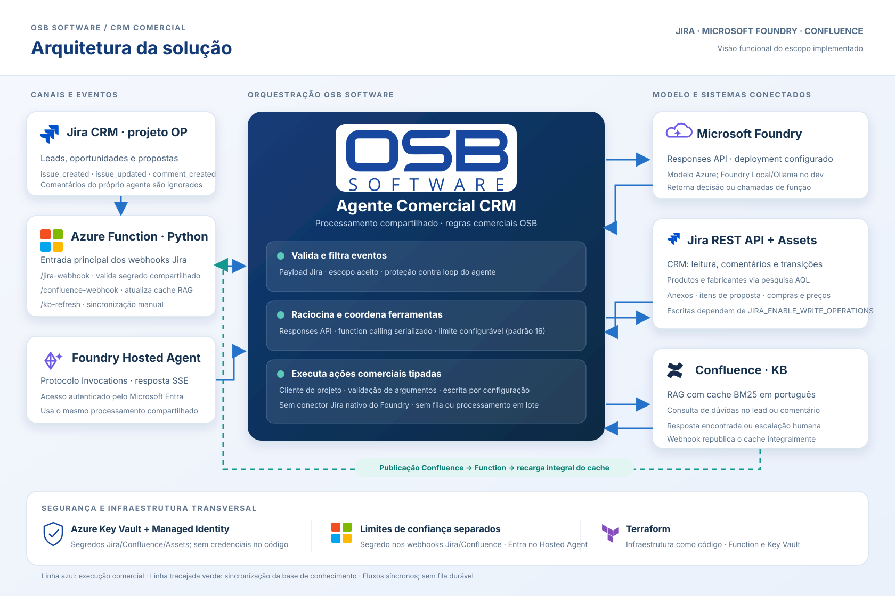

# OSB Jira Commercial CRM Agent 🤖

Agente de Inteligência Artificial que usa um modelo e a Responses API do **Microsoft Foundry** para apoiar o controle comercial no **Jira**: leads, oportunidades, propostas, itens de proposta, compras e consulta de produtos no Jira Assets. Não é um agente de triagem de incidentes de TI. O projeto mantém a Azure Function de webhook e também pode ser executado como Hosted Agent Foundry.

---

## 📌 Arquitetura da Solução

O diagrama abaixo representa os caminhos implementados: processamento Jira compartilhado pela
Function e pelo Hosted Agent, operações comerciais no Jira/Assets e consulta/sincronização da base
Confluence. A marca OSB Software identifica o agente e seu fluxo de negócio.



### Fluxos suportados

| Fluxo | Descrição sintética |
|---|---|
| Entrada e triagem de leads | Webhooks Jira de criação, atualização e comentário passam pela Function; também é possível criar leads por solicitação. O agente valida o evento, lê dados/comentários e ignora comentários próprios para evitar ciclos. |
| Atendimento pelo Hosted Agent | Invocations autenticadas pelo Microsoft Entra reutilizam o processamento comercial; a resposta é transmitida por SSE. Este endpoint não substitui o webhook Jira. |
| Qualificação e proposta | Consulta dados e comentários do lead, confirma software/fabricante no Assets, solicita dados comerciais faltantes e retoma a análise quando chega uma resposta; só gera a proposta com os nove dados obrigatórios confirmados. |
| Itens de proposta e compras | Consulta itens e campos, pesquisa produtos no Assets, encaminha itens para Compras e registra preço unitário/cenário quando solicitado; alterações dependem da habilitação de escrita. |
| Dúvidas e escalação humana | Pesquisa no Confluence com RAG; responde com conteúdo encontrado ou encaminha o lead ao grupo comercial humano quando a base não oferece resposta suficiente. |
| Anexos e apoio operacional | Consulta campos/transições, lista e baixa anexos dentro do limite configurado, adiciona notas internas e diagnostica workspaces, schemas e tipos de objeto do Assets. |
| Atualização da base de conhecimento | Webhook de publicação do Confluence ou chamada manual a `/kb-refresh` dispara uma sincronização integral do cache; não é uma atualização incremental. |

> **Importante:** este projeto não configura nem usa um conector Jira nativo do Foundry. O Foundry
> fornece o modelo e o function calling; as ferramentas são definidas pelo projeto, e a Azure
> Function executa as chamadas REST ao Jira por meio do cliente em `src/jira/connector.py`.
>
> O processamento do webhook é compartilhado por duas entradas: a Azure Function para receber
> diretamente os webhooks Jira e o Hosted Agent com protocolo `invocations`. Configure no Jira
> os eventos `issue_created`, `issue_updated` e `comment_created`; o endpoint Jira deve continuar
> apontando para a Function, que verifica o segredo do webhook. O Hosted Agent confia na
> autenticação Microsoft Entra exigida pelo endpoint Foundry; chamadas feitas pelo Playground não
> precisam repetir o segredo Jira. Restrinja quem pode invocar o Hosted Agent, pois essas chamadas
> podem executar operações Jira de escrita. Não configure o endpoint Foundry diretamente no Jira.
> O endpoint de invocações transmite a resposta em SSE e envia keep-alives a cada 15 segundos durante
> processamentos longos, como a leitura de comentários e consultas ao Assets.

### Capacidade e processamento paralelo

O webhook Jira é processado de forma síncrona: cada requisição aceita um evento, executa a triagem
e aguarda as chamadas ao Foundry e ao Jira antes de responder. Não há fila durável nem processamento
em lote nesta arquitetura. Requisições distintas podem avançar em paralelo conforme a escala dos
serviços, mas o repositório não define uma taxa garantida de leads por segundo/minuto nem um limite
explícito de requisições simultâneas por instância. O throughput real depende da duração da triagem,
do consumo de tokens, das quotas do modelo e dos limites das APIs Jira/Assets; deve ser medido no
ambiente implantado.

Valores e pontos de ajuste:

| Componente | Configuração atual / onde ajustar |
|---|---|
| Azure Function (entrada principal do Jira) | Flex Consumption, **2.048 MB por instância** e máximo configurado de **10 instâncias**, em `terraform/modules/function_app/main.tf` (`instanceMemoryMB` e `maximumInstanceCount`). Altere esses valores para reduzir/aumentar os recursos e o teto de escala da Function. O número de instâncias não equivale a uma garantia de requisições simultâneas ou leads/minuto. |
| Hosted Agent Foundry (entrada adicional) | `azure.yaml`, em `container.resources`: **0,5 CPU e 1 GiB**. Ajuste `cpu`/`memory` e publique novamente o Hosted Agent. O repositório não fixa a quantidade máxima de réplicas nem a concorrência desse serviço; confira os limites de escala do ambiente Foundry. |
| Deployment do modelo Foundry | `azure_ai_model_capacity` em `terraform/variables.tf`, cujo exemplo é `50` em `terraform/terraform.tfvars.example` (capacidade em milhares de tokens por minuto, conforme o SKU/modelo e a região). Ajuste respeitando disponibilidade, quota e limites do deployment; isso aumenta ou diminui capacidade de tokens, não uma quantidade direta de leads. |
| Chamadas de ferramentas por triagem | `AZURE_AI_MAX_TOOL_CALLS`, padrão **16**, em `src/config.py`. É um limite por execução, não um limite de leads paralelos. As chamadas de ferramenta do modelo são explicitamente serializadas (`parallel_tool_calls=False`) em `src/agent/triage_agent.py`; aumentar esse limite pode prolongar uma triagem, não aumentar sua concorrência. |

Para aumentar ou reduzir a escala, altere a configuração do componente relevante e aplique-a ao
ambiente de destino: mudanças Terraform exigem revisar o plano e aplicar a infraestrutura; mudanças
no Hosted Agent exigem novo deploy. Depois, faça um teste de carga controlado e acompanhe latência,
erros, throttling, consumo de tokens e limites do Jira. Aumentar somente o máximo de instâncias da
Function pode não elevar a vazão se o gargalo estiver no modelo ou no Jira. Para absorver picos sem
manter cada webhook aguardando toda a triagem, seria necessário introduzir uma fila e processamento
assíncrono, o que não está implementado atualmente.

### Principais Pilares

1. **Microsoft Foundry**: Fornece o modelo pela Responses API na Azure ou por um endpoint local OpenAI-compatible do Foundry Local; a Function ou o Hosted Agent executa o ciclo de function calling.
2. **Azure Functions e Foundry Hosted Agent**: A Function recebe webhooks Jira; o serviço Hosted Agent oferece uma entrada compatível com o protocolo Invocations.
3. **Cliente Jira implementado pelo projeto**: Executa operações tipadas na API REST do Jira e Assets usando credenciais guardadas fora do código; não é um conector nativo do Foundry.
4. **Segurança Enterprise**:
   - Autenticação com serviços Azure via **Managed Identity** (`DefaultAzureCredential`).
   - Validação de webhooks com verificação em tempo constante (`hmac.compare_digest`) contra o segredo configurado no ambiente da Function.
5. **Infraestrutura como Código (Terraform)**: Provisiona Key Vault e Function App e integra com um projeto Foundry existente.
6. **Tooling Moderno**: Gerenciamento ultrarrápido com `uv` e testes automatizados com `pytest`.

---

## 📁 Estrutura do Repositório

```text
osb-jira-agent/
├── .github/
│   └── workflows/
│       └── ci.yml                 # Pipeline CI (Lint, Test, Terraform check)
├── terraform/                     # Infraestrutura como Código modular
│   ├── main.tf                    # Orquestração principal dos módulos
│   ├── variables.tf               # Variáveis de entrada
│   ├── outputs.tf                 # Endpoints e IDs provisionados
│   ├── terraform.tfvars.example   # Modelo de variáveis locais
│   └── modules/
│       ├── ai_foundry/            # Módulo opcional de AI Services/model deployment; não usado pelo root atual
│       ├── key_vault/             # Key Vault e gestão de segredos
│       └── function_app/          # Storage, Function App e RBAC
├── src/
│   ├── agent/
│   │   ├── foundry_client.py      # Conexão com Foundry via DefaultAzureCredential
│   │   ├── prompts.py             # Prompt comercial e regras de negócio
│   │   └── triage_agent.py        # Orquestração de operações comerciais e function calling
│   ├── jira/
│   │   ├── connector.py           # Cliente REST Jira/Assets e execução das ferramentas
│   │   └── tools.py               # Definições e schemas das ferramentas permitidas
│   ├── models/
│   │   ├── agent_result.py        # Modelos Pydantic de saída da decisão
│   │   └── jira_webhook.py        # Modelos Pydantic de payload do Jira
│   ├── security/
│   │   └── webhook_verifier.py    # Validação de token e HMAC do webhook
│   ├── hosted_agent/
│   │   └── main.py                # Adapter do protocolo Foundry Invocations
│   ├── utils/
│   │   └── logger.py              # Logging formatado
│   ├── config.py                  # Pydantic Settings e variáveis de ambiente
│   ├── function_app.py            # Entrada HTTP da Azure Function
│   └── webhook_handler.py         # Processamento compartilhado entre as entradas
├── tests/
│   ├── conftest.py                # Fixtures e payloads de exemplo
│   ├── test_function_app.py       # Testes dos endpoints HTTP da Function
│   ├── test_hosted_agent.py       # Testes do adapter Foundry Invocations
│   ├── test_triage_agent.py       # Testes do prompt comercial e parsing de decisão
│   └── test_webhook_security.py   # Testes de validação de segurança
├── scripts/
│   ├── get-webhook-endpoint.sh    # Consulta endpoint real e valida saúde da Function
│   ├── dev.sh                     # Utilitários de desenvolvimento (test, lint, format)
│   └── check-local-prereqs.sh     # Validação de pré-requisitos para modelos locais
├── function_app.py                # Ponto de entrada raiz do Azure Functions host
├── host.json                      # Configuração do runtime do Azure Functions
├── local.settings.json.example    # Variáveis para emulação local do Azure Functions
├── pyproject.toml                 # Dependências gerenciadas via uv
├── Makefile                       # Comandos rápidos de automação
├── .env.example                   # Exemplo de variáveis de ambiente
├── azure.yaml                     # Serviço Hosted Agent para Azure Developer CLI
├── FINE-TUNNING.md                # Guia de engenharia de prompts, assertividade e testes
└── README.md                      # Documentação do projeto
```

---

## Microsoft Foundry Hosted Agent

Para atualizar a versão implantada, consulte o [guia de implantação](./DEPLOYMENT.md).

O serviço em `azure.yaml` declara um Hosted Agent de código Python 3.13 usando o protocolo
`invocations` 2.0.0. O adapter em `src/hosted_agent/main.py` encaminha o corpo bruto e os headers
para `src/webhook_handler.py`, a mesma rotina chamada pela Function. A validação do payload, o
filtro de eventos e a triagem são compartilhados; cada entrada autentica segundo seu próprio
limite de confiança.
Campos Jira `customfield_*` recebidos no webhook são incluídos como snapshot no contexto do modelo.
Quando a solicitação pede valores ou comentários atuais, o agente consulta as ferramentas Jira de
leitura e distingue o estado consultado do snapshot do evento.

O Hosted Agent usa um projeto Foundry e um deployment de modelo. O Terraform provisiona a conta,
o projeto e o deployment GPT-5 para a Function; `azure.yaml` não contém endpoint, ID ARM nem
credenciais. O runtime fornece `FOUNDRY_PROJECT_ENDPOINT`, aceito como alias de
`AZURE_AI_PROJECT_ENDPOINT`; configure `AZURE_AI_MODEL_DEPLOYMENT_NAME` para corresponder ao
deployment provisionado. O ambiente Azure ativo usa `ENVIRONMENT=development`.

As credenciais Jira e o segredo do webhook são dados sensíveis: não os coloque em `azure.yaml`.
O Hosted Agent lê `jira-api-token` e, se existir, `jira-assets-access-token` diretamente do Azure
Key Vault usando a identidade do próprio agente (`DefaultAzureCredential`). O token Jira é também
usado pelo Confluence por padrão. O segredo `jira-webhook-secret` é validado pela Azure Function,
que recebe os webhooks diretos do Jira. A identidade Hosted Agent precisa de `Key Vault Secrets
User` no vault; o Terraform deste repositório configura essa permissão para a Function, mas não
para a identidade Hosted Agent. Os valores não são copiados para variáveis do `azd`, manifestos ou
logs. As configurações não secretas `JIRA_*` e `JIRA_KEY_VAULT_URL` são fornecidas pelo ambiente
`azd`.

Como o serviço usa `dependencyResolution: remote_build`, mantenha `requirements.txt` sincronizado
com `uv.lock` sempre que alterar dependências de runtime:
`uv export --format requirements-txt --no-dev --no-hashes --no-emit-project -o requirements.txt`.
O build remoto do Foundry instala as dependências declaradas nesse arquivo.

O Jira deve continuar apontando para a Function App como entrada de webhooks. O endpoint Invocations
do Foundry exige autenticação Microsoft Entra e não deve ser configurado diretamente como webhook
Jira. A Function mantém a validação da assinatura do Jira; o Hosted Agent aceita chamadas de
usuários autenticados e autorizados no Foundry.

Para depurar no VS Code, instale as dependências com `uv sync --all-extras --group dev` e escolha
**Attach to Foundry Hosted Agent**. A configuração inicia `agentdev run` no servidor Invocations,
abre o Agent Inspector e conecta o debugger. Isso é separado de `func start`; nenhum servidor é
iniciado durante a instalação.

---

## 🚀 Como Executar Localmente

### 1. Pré-requisitos
- Python 3.11, 3.12 ou 3.13
- [uv](https://docs.astral.sh/uv/) instalado (`curl -LsSf https://astral.sh/uv/install.sh | sh`)
- [Azure Functions Core Tools](https://learn.microsoft.com/azure/azure-functions/functions-run-local) (`npm i -g azure-functions-core-tools@4`)
- [Azure CLI](https://learn.microsoft.com/cli/azure/install-azure-cli) (`az login`)
- Para verificar os requisitos locais, use `./scripts/check-local-prereqs.sh`. O script faz o pré-flight
  e solicita confirmação interativa antes de instalar ou atualizar componentes; use `--check-only`
  para apenas diagnosticar ou `--update` para incluir atualizações no plano. Ele instala Azurite
  somente quando `AzureWebJobsStorage` usa `UseDevelopmentStorage=true`.

### 2. Instalação das Dependências

Utilize o `uv` para sincronizar o ambiente virtual isolado:

```bash
make install
# ou diretamente:
uv sync --all-extras --group dev
```

### 3. Configuração de Ambiente

Copie os modelos de configuração e preencha com as credenciais do seu ambiente:

Para entender o papel de cada arquivo de configuração e quando ele é utilizado, consulte
[SETTINGS.md](./SETTINGS.md).

```bash
test -f .env || cp .env.example .env
test -f local.settings.json || cp local.settings.json.example local.settings.json
```

Variáveis chave em `.env` / `local.settings.json`:
- `MODEL_PROVIDER`: `azure` (padrão), `foundry-local` ou `ollama`.
- `AZURE_AI_PROJECT_ENDPOINT`: Endpoint completo do projeto Foundry (`https://<account>.services.ai.azure.com/api/projects/<project>`).
- `FOUNDRY_PROJECT_ENDPOINT`: alias aceito para o endpoint injetado pelo runtime Hosted Agent.
- `AZURE_AI_MODEL_DEPLOYMENT_NAME`: Nome de um modelo já implantado nesse projeto.
- `FOUNDRY_LOCAL_MODEL_ALIAS`: Alias do modelo instalado localmente (padrão `phi-4-mini`).
- `FOUNDRY_LOCAL_BASE_URL`: Endpoint OpenAI-compatible local (padrão `http://127.0.0.1:5273/v1`).
- `OLLAMA_MODEL_NAME`: Nome do modelo instalado no Ollama (padrão `qwen3:4b`).
- `OLLAMA_BASE_URL`: Endpoint OpenAI-compatible local do Ollama (padrão `http://127.0.0.1:11434/v1`).
- `JIRA_WEBHOOK_SECRET`: Token ou segredo compartilhado para validar requisições do Jira.
- `JIRA_INSTANCE_URL`: URL base da organização no Atlassian Cloud.
- `JIRA_API_EMAIL` e `JIRA_API_TOKEN`: credenciais Basic Auth para a API Jira.
- `JIRA_KEY_VAULT_URL`: URL do Key Vault cujos segredos Jira são carregados pelo Hosted Agent;
  a identidade local autenticada com `az login` precisa ter acesso de leitura aos segredos.
- `JIRA_TEAM_ACCOUNT_IDS`: JSON opcional que associa nomes de equipe a `accountId`s do Jira, se uma atribuição for explicitamente solicitada.
- `JIRA_ALLOWED_PROJECT_KEYS`: lista JSON dos projetos que as ferramentas podem acessar.
- `JIRA_ENABLE_WRITE_OPERATIONS`: habilita explicitamente criação, comentários, transições e write-back.
- `CONFLUENCE_SPACE_URL`: URL completa do espaço Confluence da base de conhecimento (neste projeto, `https://loonar-osb.atlassian.net/wiki/spaces/osbjiraage`).
- `CONFLUENCE_BASE_URL`: URL base da API do Confluence (`https://loonar-osb.atlassian.net/wiki`).
- `CONFLUENCE_SPACE_KEY`: Chave do espaço Confluence (`osbjiraage` neste projeto).
- `CONFLUENCE_API_EMAIL` e `CONFLUENCE_API_TOKEN`: credenciais opcionais exclusivas do Confluence;
  se não forem definidas, o conector usa `JIRA_API_EMAIL` e `JIRA_API_TOKEN`.
- `CONFLUENCE_WEBHOOK_SECRET`: Token compartilhado exigido pelo endpoint do webhook do Confluence.
- `CONFLUENCE_WEBHOOK_SECRET_HEADER`: Nome do cabeçalho com o token (padrão `X-Atlassian-Webhook-Secret`).
- `JIRA_REQUEST_DETAILS_FIELD_ID`: campo Jira para "Detalhes da Solicitação" (padrão `customfield_10120` na instância consultada).
- `KB_CACHE_DIR`: Diretório para persistência do cache RAG (padrão `.cache/kb`).
- `KB_CACHE_TTL_SECONDS`: TTL do cache da base de conhecimento em segundos (padrão `3600`).
- `KB_MIN_CONFIDENCE_SCORE`: Limiar de confiança para validação de respostas encontradas (padrão `0.35`).
- `KB_HUMAN_ESCALATION_TEAM`: Nome da equipe humana de escalação quando a dúvida não for respondida (padrão `Equipe Comercial Humana`).

O modo de escrita é **desabilitado por padrão**, mesmo quando as credenciais estão presentes.
Defina `JIRA_ENABLE_WRITE_OPERATIONS=true` apenas depois de validar o projeto e os IDs de transição
no Jira. Quando habilitado, o agente pode executar apenas as operações comerciais de escrita
explicitamente solicitadas; por padrão, prioridade, atribuição, status genérico e comentário interno
ficam sem alteração. A atribuição só é feita para equipes presentes em `JIRA_TEAM_ACCOUNT_IDS`.
As ferramentas rejeitam chaves de issue
fora de `JIRA_ALLOWED_PROJECT_KEYS` e verificam se a transição indicada está disponível antes de
executá-la. Sem credenciais Jira, o agente não consegue consultar nem alterar issues.
O conector também consulta, em modo somente leitura, os metadados de criação de um tipo de issue
em um projeto permitido (`get_project_issue_type_metadata`). A criação de leads resolve os campos
comerciais pelo nome e tipo retornados pelo Jira, incluindo contato, telefone e detalhes da solicitação;
as opções como origem do lead são validadas contra as opções atuais do campo.

### Usar Foundry Local durante o desenvolvimento

O backend Azure continua sendo o padrão e preserva a Responses API. Para usar o modelo no
computador, escolha `MODEL_PROVIDER=foundry-local` em `.env` e `local.settings.json`, e informe
o alias do modelo em `FOUNDRY_LOCAL_MODEL_ALIAS`. O script prepara o SDK Foundry Local, baixa
os execution providers e o modelo se necessário, carrega-o e valida uma chamada de ferramenta
antes de informar sucesso:

```bash
./scripts/check-local-prereqs.sh --provider foundry-local
```

O script exibe as ações previstas e pede confirmação antes de sincronizar dependências ou baixar
runtime/modelos. Para somente inspecionar os pré-requisitos, use
`./scripts/check-local-prereqs.sh --provider foundry-local --check-only`. Para escolher outro
alias: `--model <alias>`. Depois da preparação, inicie a Function como de costume (`make run` ou
`func start`). O processo Python carrega o modelo e inicia o endpoint local; nenhuma chamada ao
Azure Foundry é feita neste modo.

Esse modo mantém as ferramentas do agente no código da Function. O Jira Cloud e suas APIs ainda
são serviços externos e exigem conectividade e credenciais; apenas o modelo é executado no
computador. Para usar Azurite, mantenha `AzureWebJobsStorage=UseDevelopmentStorage=true`; ele
emula o armazenamento Azure exigido pelo host local e não tem relação com o modelo. Com outra
configuração de armazenamento, Azurite não é necessário.

### Usar Ollama durante o desenvolvimento

O Ollama é uma alternativa local que não usa o SDK nativo Foundry Local. Instale o Ollama pelo
[site oficial](https://ollama.com/download), inicie seu serviço e configure `.env` para usar
`MODEL_PROVIDER=ollama`, `OLLAMA_MODEL_NAME=qwen3:4b` e
`OLLAMA_BASE_URL=http://127.0.0.1:11434/v1`. Qwen3:4b é a opção inicial recomendada para testar
tool calling; a disponibilidade de memória e a velocidade dependem da quantização e do hardware
local.

Para baixar o modelo e testar function calling sem iniciar a Function:

```bash
./scripts/check-local-prereqs.sh --provider ollama
```

O script pede confirmação antes de baixar o modelo e valida a chamada de ferramenta no endpoint
local. Para apenas conferir o estado, use `--check-only`. O Jira continua sendo acessado pela
rede e exige credenciais; apenas as inferências do modelo ficam locais.

Depois que o modelo passar na verificação, use `make run-ollama` para iniciar a Azure Function
com o backend local. Esse alvo define as variáveis Ollama para o processo sem alterar seu `.env`
ou sobrescrever credenciais locais; para usar outro modelo, defina `OLLAMA_MODEL_NAME` antes do
comando.

### Ferramentas comerciais e avaliação de leads

As operações comerciais estão expostas como function tools nomeadas e com argumentos
validados. O agente não recebe acesso a URLs, métodos HTTP nem payloads Jira arbitrários.
Para leads do projeto OP, o agente lê campos e comentários, procura no Assets o software
informado pelo solicitante e atualiza o campo Jira `Fabricante`/`Manufacturer` se a relação
for inequívoca. Se faltarem dados comerciais, publica um comentário para o lead/contato comercial e
retoma a avaliação quando receber uma resposta. A proposta só é iniciada quando todos os
nove campos exigidos pela transição estiverem disponíveis. A resposta é um comentário visível
na issue OP; o envio de e-mail depende do esquema de notificações do projeto Jira. Todo comentário
público sobre o lead e sua proposta deve ser escrito diretamente ao lead/contato comercial em tom
cordial, natural e profissional, pois o Jira pode enviá-lo por e-mail. Isso inclui pedidos de dados,
esclarecimentos e atualizações de andamento ou conclusão. Não se deve dirigir a mensagem ao operador
Jira, expor detalhes técnicos internos, nem repetir cabeçalho ou assinatura: o Jira exibe a conta
autenticada como autora.

Se o campo Jira do fabricante não tiver o nome `Fabricante`, `Manufacturer` ou
`Software manufacturer`, configure `JIRA_MANUFACTURER_FIELD_ID` com o ID de um campo
editável. O conector grava uma string em campos de texto ou a referência de objeto em campos
Assets; para estes últimos, o resultado do Assets precisa incluir o ID do objeto fabricante.
Configure `JIRA_AGENT_ACCOUNT_ID` com o account ID Jira da conta de automação para detectar
comentários próprios pelo autor. Quando esse ID não for configurado, o conector o consulta ao Jira
para reconhecer comentários publicados pela conta autenticada.

| Área | Ferramentas |
|---|---|
| Leads | `create_lead`, `get_lead_details`, `get_latest_issue_comment`, `update_lead_manufacturer`, `start_lead_work`, `transition_lead_to_proposal_item`, `generate_new_proposal` |
| Issues e itens da proposta | `get_issue_fields`, `find_proposal_items`, `get_proposal_item_values`, `send_item_to_purchasing`, `set_proposal_item_price` |
| Comentários e anexos | `add_internal_comment`, `add_public_comment`, `list_issue_attachments`, `download_issue_attachment` |
| Assets | `get_assets_cloud_id`, `get_assets_workspaces`, `list_assets_schemas`, `get_assets_object_types`, `search_assets_products_by_manufacturer`, `search_assets_products_by_software` |
| Base de Conhecimento e Dúvidas | `query_knowledge_base`, `escalate_to_human_group` |

### Base de Conhecimento Confluence, RAG e Escalação Humana

O agente conta com um mecanismo RAG para esclarecer dúvidas apresentadas pelo lead no momento da
recepção (no campo `Detalhes da Solicitação` ou descrição) e quando o lead responde a comentários:

1. **Espaço Confluence como Base de Conhecimento**:
   - Este projeto usa `CONFLUENCE_SPACE_URL=https://loonar-osb.atlassian.net/wiki/spaces/osbjiraage`,
     `CONFLUENCE_BASE_URL=https://loonar-osb.atlassian.net/wiki` e
     `CONFLUENCE_SPACE_KEY=osbjiraage`; os exemplos e o Terraform já trazem esses valores.
   - Por padrão, o acesso usa `JIRA_API_EMAIL` e `JIRA_API_TOKEN`. Só configure
     `CONFLUENCE_API_EMAIL` e `CONFLUENCE_API_TOKEN` se forem diferentes.

2. **Cache local e RAG**:
   - As páginas são particionadas em chunks com sobreposição e indexadas via algoritmo BM25 com normalização para português (remoção de acentos e stopwords).
   - O cache em disco é persistido em `KB_CACHE_DIR` (padrão `.cache/kb`) e respeita o TTL em segundos (`KB_CACHE_TTL_SECONDS`).

3. **Fallback direto durante atualização**:
   - Quando o cache está em processo de atualização/sincronização (`is_updating`), qualquer consulta à ferramenta `query_knowledge_base` aciona automaticamente o fallback direto via Confluence CQL (`search_space_direct`), garantindo disponibilidade contínua sem respostas desatualizadas.

4. **Atualização via Webhook**:
   - Configure o webhook como descrito em [Configurar o webhook do Confluence](#configurar-o-webhook-do-confluence).
   - Cada evento aceito dispara uma sincronização completa do cache da base de conhecimento; não é uma atualização incremental.

5. **Escalação para Grupo de Humanos**:
   - Caso a base de conhecimento não contenha resposta com similaridade suficiente (abaixo de `KB_MIN_CONFIDENCE_SCORE`), o agente aciona `escalate_to_human_group`.
   - O lead é transferido para a equipe humana configurada (`KB_HUMAN_ESCALATION_TEAM`, `KB_HUMAN_ESCALATION_GROUP_ACCOUNT_ID`, `KB_HUMAN_ESCALATION_TRANSITION_ID`), com registro de nota interna detalhando o motivo e mensagem pública cordial ao cliente informando o encaminhamento a um consultor.

#### Configurar o webhook do Confluence

O endpoint `POST /api/confluence-webhook` deve ser acessível por HTTPS pela automação do Confluence.
Em Azure Functions, use `https://<nome-da-function-app>.azurewebsites.net/api/confluence-webhook`.
Em desenvolvimento local, o endpoint não é acessível pelo Confluence sem um túnel HTTPS público; prefira
testá-lo em uma Function de desenvolvimento publicada.

1. Gere um token aleatório forte e configure-o como `CONFLUENCE_WEBHOOK_SECRET`:
   - localmente, em `.env` ou `local.settings.json`;
   - na Azure Function publicada, preencha `confluence_webhook_secret` em `terraform.tfvars`.
     Use um segredo aleatório exclusivo de pelo menos 32 caracteres; não reutilize o token da API
     Jira. O Terraform valida o tamanho, grava o valor no Key Vault e configura a referência no App
     setting da Function.
     Se a Function não for gerenciada pelo Terraform, configure o segredo no Key Vault e seu
     App setting por referência; não o coloque no código ou em arquivos versionados.
2. Na mesma configuração, defina `CONFLUENCE_WEBHOOK_SECRET_HEADER` como
   `X-Atlassian-Webhook-Secret` (o padrão) ou escolha outro nome de cabeçalho usando
   `confluence_webhook_secret_header` em `terraform.tfvars`. O nome precisa ser exatamente o mesmo
   usado na regra do Confluence. Em produção, sem `CONFLUENCE_WEBHOOK_SECRET` configurado, o
   endpoint rejeita a requisição.
3. No Confluence Cloud, crie uma regra de automação no espaço da base de conhecimento:
   - escolha o gatilho de publicação da página (para novas páginas e republicações/alterações);
   - adicione a ação **Send web request**;
   - use o método `POST` e a URL HTTPS da Function acima;
   - adicione um cabeçalho com o nome configurado no passo 2 e o token do passo 1 como valor;
   - envie um corpo JSON válido, por exemplo `{}`; o endpoint também usa a chave do espaço no corpo,
     quando fornecida, para ignorar eventos de outros espaços.
4. Salve e habilite a regra. Publique ou altere uma página do espaço e confira o resultado da regra
   no log de auditoria do Confluence e os logs da Function. Uma resposta `200` indica que o evento
   foi aceito; um evento de outro espaço pode retornar `200` com estado `ignored`. `401` indica
   cabeçalho ausente/incorreto ou segredo não configurado; `500` indica falha de sincronização.

O endpoint da Function usa autenticação HTTP anônima do Azure Functions e protege o recebimento com
esse token compartilhado; portanto, não é necessário acrescentar uma Function Key à URL. Restrinja
o acesso às configurações que guardam o token e mantenha o mesmo valor somente na Function e na
regra de automação. Essa integração espera um cabeçalho estático com o token configurado; ela não
valida JWT de aplicativos Atlassian Connect nem assinaturas HMAC de webhooks nativos.

Consulte também a documentação da Atlassian sobre
[automação do Confluence](https://support.atlassian.com/confluence-cloud/docs/what-is-confluence-automation/)
e a ação [Send web request](https://support.atlassian.com/cloud-automation/docs/).

`JIRA_TRANSITION_IDS` permite substituir os IDs de workflow dos manifestos. Os IDs fornecidos são
específicos da instância original; confirme-os no workflow de destino. O download de anexos só
permite anexos pertencentes à issue indicada e tem limite configurável em
`JIRA_ATTACHMENT_MAX_BYTES` (64 KiB por padrão). Notas adicionadas pela ferramenta são sempre
internas. A pesquisa AQL usa `JIRA_ASSETS_PRODUCT_OBJECT_TYPE_ID` (157 por padrão).

Quando configurado, `JIRA_ASSETS_ACCESS_TOKEN` é tentado primeiro como Bearer. Se Jira Assets
responder `401 Unauthorized`, o conector tenta novamente com as credenciais Jira Basic já
configuradas; sem token Assets, usa Basic diretamente. Se ambas as tentativas falharem, o erro
é retornado explicitamente. Um `403 Forbidden` não aciona fallback, pois indica falta de
permissão e não necessariamente falha de autenticação. Para reduzir consumo de tokens nas
respostas do modelo, cada pesquisa AQL limita a página a cinco candidatos e retorna apenas ID,
chave, nome e fabricante; o total e o indicador de mais resultados são preservados. Quando houver
mais resultados ou nomes ambíguos, o agente deve pedir esclarecimentos, não escolher um produto
por suposição.

Para chamadas Jira Assets, configure `JIRA_ASSETS_CLOUD_ID` e `JIRA_ASSETS_WORKSPACE_ID` para
evitar descoberta automática. Se houver um único workspace, o conector pode descobri-lo. A API
Assets usa `JIRA_ASSETS_ACCESS_TOKEN` como Bearer quando fornecido; caso contrário, usa o API token
Jira configurado, somente contra o host Atlassian fixo `api.atlassian.com`.

O Terraform usa um projeto Foundry e um deployment de modelo existentes; ele não cria o projeto.
Informe o endpoint em `azure_ai_project_endpoint`, o deployment em
`azure_ai_model_deployment_name` e o Resource ID ARM da conta AI Services em
`azure_ai_services_id`, para que o RBAC da Managed Identity seja aplicado à conta correta. A antiga
`AZURE_AI_PROJECT_CONNECTION_STRING` é aceita apenas como fallback de compatibilidade; prefira o
endpoint explícito do projeto. Para o Hosted Agent, `FOUNDRY_PROJECT_ENDPOINT` também é aceito
como alias pelo runtime.

Crie um API token Atlassian para uma conta de agente com as permissões necessárias para consultar e editar
issues, adicionar notas internas e executar transições no Jira. Localmente,
guarde os tokens apenas no `.env` ou `local.settings.json` (ambos ignorados pelo Git). No Terraform,
`jira_api_email`, `jira_api_token` e `jira_assets_access_token` são configurados; os tokens são
armazenados no Key Vault e referenciados pela Function App. Embora o Terraform marque os tokens
como sensíveis, eles também podem constar no state; use backend de state protegido e nunca versione
state ou `terraform.tfvars`. Configure account IDs, por exemplo:

```json
{"Cloud-Platform": "account-id-do-jira", "ServiceDesk-L1": "outro-account-id"}
```

### 4. Execução dos Testes Automatizados

Execute a suíte de testes unitários com `pytest`:

```bash
make test
# ou:
uv run pytest --verbose
```

### 5. Iniciar a Function App Localmente

Para iniciar o runtime de emulação do Azure Functions:

```bash
make run
# ou:
func start
```

O endpoint estará acessível em:
```text
http://localhost:7071/api/jira-webhook
```

---

## 🔐 Configuração do Webhook no Jira

Para consultar a URL real da Function App implantada e validar se ela está online:

```bash
./scripts/get-webhook-endpoint.sh
```

Para obter apenas a URL (útil para copiar ou scripts de automação):

```bash
./scripts/get-webhook-endpoint.sh --url-only
```

### Passo a passo no Jira

1. No Jira, acesse **Configurações (Jira Settings)** > **Sistema (System)** > **Webhooks** (`/plugins/servlet/webhooks`).
2. Clique em **Create a Webhook**.
3. **URL**: Informe a URL retornada pelo script (`https://<sua-function-app>.azurewebsites.net/api/jira-webhook`).
4. Em **Headers**, adicione:
   - Header Name: `X-Atlassian-Webhook-Secret`
   - Value: `<valor-do-JIRA_WEBHOOK_SECRET>`
5. Em **Scope / JQL**:
   - `project = "OP"` (restringe o disparo exclusivamente às oportunidades/leads comerciais tratados pelo agente).
6. Em **Events** (Eventos necessários para autonomia total):

| Categoria Jira | Evento na interface | Identificador aceito no payload | Papel na operação autônoma |
|---|---|---|---|
| **Issue** | **Created** | `jira:issue_created` / `issue_created` | Ativação inicial quando um novo lead comercial é cadastrado no projeto OP. O agente avalia os campos, busca software no Assets, atualiza o fabricante e define o próximo passo. |
| **Issue** | **Updated** | `jira:issue_updated` / `issue_updated` | Dispara quando campos ou status do lead/oportunidade são alterados no Jira, permitindo reavaliação contínua do fluxo de proposta. |
| **Comment** | **Created** | `comment_created` / `jira:issue_comment_created` | **Essencial para diálogo e autonomia**: quando o solicitante responde às perguntas do agente fornecendo dados pendentes (ex: prazos, produtos, quantidades), o agente retoma o fluxo automaticamente sem intervenção humana. Comentários criados pelo próprio agente são detectados e ignorados automaticamente para evitar loops. |

> **Nota de configuração:** Certifique-se de marcar tanto os eventos de **Issue** (`created` e `updated`) quanto de **Comment** (`created`). Sem o evento de comentário, o agente não saberá quando o cliente responder às solicitações de esclarecimento.
>
> Se o payload recebido não incluir `webhookEvent`, uma issue válida ainda será processada. IDs numéricos do Jira são normalizados para texto durante a validação.

7. Salve o webhook.

---

## 🏗️ Provisionamento com Terraform

O Terraform configura uma Function App Linux no plano **Flex Consumption (`FC1`)**, usando o
projeto Foundry provisionado pelo mesmo módulo Terraform. A infraestrutura inclui Key Vault,
Storage Account, container privado para o pacote de deployment, identidade gerenciada de usuário
para acessar esse pacote e identidade gerenciada de sistema para Foundry e Key Vault.

```bash
cd terraform
test -f terraform.tfvars || cp terraform.tfvars.example terraform.tfvars
# Edite as variáveis conforme desejado em terraform.tfvars
```

O `terraform.tfvars` local gerado a partir de `local.settings.json` é ignorado pelo Git. O Terraform
cria uma conta Azure AI Services, um projeto Foundry e um deployment GPT-5 na assinatura indicada
por `subscription_id`; o endpoint e o Resource ID usados pelo app são derivados desses recursos.
O deployment usa `GlobalStandard` com capacidade inicial de 50 mil tokens por minuto.
As variáveis `confluence_space_url`, `confluence_base_url` e `confluence_space_key` configuram a
base Confluence da Function. Quando necessárias credenciais Confluence independentes, informe
`confluence_api_email` e `confluence_api_token`; configure também `confluence_webhook_secret` para
habilitar a autenticação do webhook. O Terraform guarda os tokens e o segredo no Key Vault e
configura referências para a Function, sem colocar os valores nos App settings em texto simples.

Antes de qualquer implantação futura, confirme:

- A quota/capacidade **Flex Consumption** está disponível na região escolhida; a quota
  anterior de `Y1` não confirma disponibilidade de `FC1`.
- O Terraform atribui **Key Vault Secrets Officer** à identidade usada pelo AzureRM, no escopo do
  novo Key Vault, para criar os segredos com RBAC habilitado.
- A identidade usada pelo Terraform pode criar atribuições RBAC nos escopos do Storage Account e
  conta Foundry e Key Vault. `Contributor` sozinho não concede `roleAssignments/write`; use
  `Role Based Access Control Administrator`, `User Access Administrator` ou `Owner` no escopo
  adequado.
- O state do Terraform está protegido: ele pode conter os segredos Jira e a connection string da
  Storage Account usada pelo host de Functions.

Antes do `apply`, confirme a quota/capacidade e revise o plano; a implantação requer aprovação
explícita:

```bash
terraform -chdir=terraform init
terraform -chdir=terraform validate
terraform -chdir=terraform plan -input=false
# Após revisar o plano: terraform -chdir=terraform apply
```

O repositório usa o backend local do Terraform: `terraform.tfstate` pode conter tokens e outros
valores sensíveis e não é versionado. Em um clone novo, **não aplique** sem recuperar com segurança
o state correspondente ou importar os recursos existentes; para uso compartilhado, configure um
backend remoto Azure Storage antes de operar a infraestrutura. O `terraform apply` provisiona
recursos e configurações, mas não publica o código Python da Function nem cria uma nova versão do
Hosted Agent. Publique o código da Function com `func azure functionapp publish` e o Hosted Agent
com `azd deploy`, conforme [DEPLOYMENT.md](./DEPLOYMENT.md).

O Terraform configurará automaticamente as atribuições de RBAC:
- **Key Vault Secrets Officer** para a identidade de implantação escrever os segredos no vault.
- **Storage Blob Data Contributor** para a identidade gerenciada de usuário acessar o container de deployment.
- **Cognitive Services OpenAI User** para a Managed Identity da Function App na conta Foundry informada.
- **Key Vault Secrets User** para a Function App acessar os segredos com segurança.

Tokens e segredos marcados como sensíveis podem ser gravados no state do Terraform. Use um backend
protegido e nunca versione `terraform.tfvars` ou arquivos de state.

O Terraform provisiona os recursos da Function App, mas não publica o código Python. Depois do
provisionamento, publique o código com Azure Functions Core Tools (`func azure functionapp publish
<function-app-name>`) e configure o webhook Jira para a URL de saída `webhook_endpoint_url`.

---

## 📦 CI/CD com GitHub Actions

O repositório inclui uma pipeline pronta em `.github/workflows/ci.yml`:
- **Lint e Formatação**: `ruff check` e `ruff format --check`.
- **Testes Unitários**: `pytest` com relatório detalhado.
- **Validação de Infraestrutura**: `terraform fmt -check` e `terraform validate`.

---

## 📄 Licença

Este projeto é desenvolvido para uso interno de integração entre Microsoft Foundry e Jira CRM/Assets.

## Foundry Toolkit Agent Inspector

O Hosted Agent (`src/hosted_agent/main.py`) inicia um servidor HTTP do protocolo Invocations.
O `agent-dev-cli` está no grupo `dev` do `pyproject.toml`; instale-o com
`uv sync --all-extras --group dev` (ou `make install`). No VS Code, pressione F5 e escolha
**Attach to Foundry Hosted Agent**: a task executa `agentdev run` na porta 8088 com debugpy na
porta 5679, abre o Agent Inspector e encerra as tasks quando a sessão de depuração termina.

Para coletar traces localmente, antes de pressionar F5 abra **Foundry Toolkit** na Activity Bar,
acesse **Developer Tools > Monitor > Tracing** e inicie o collector. A task do Hosted Agent exporta
OpenTelemetry por HTTP/protobuf para `http://localhost:4318`; depois de exercitar o agente, atualize
a lista de traces nessa mesma tela. O runtime instrumenta requisições e chamadas de modelo; cada
execução de ferramenta Jira também produz um span `jira.execute_tool`, com o nome da ferramenta,
sem incluir argumentos, respostas ou conteúdo de prompts. A captura de conteúdo está desativada.

No ambiente hospedado, o runtime do protocolo Invocations já configura OpenTelemetry. Para ver os
traces do Hosted Agent no Foundry, conecte um recurso Application Insights ao projeto Foundry; a
plataforma injeta a connection string no container. Consulte
[configuração de tracing para hosted agents](https://learn.microsoft.com/azure/foundry/agents/how-to/configure-hosted-agent-telemetry)
e [tracing local no Foundry Toolkit](https://learn.microsoft.com/azure/foundry/how-to/develop/vs-code-tracing).
